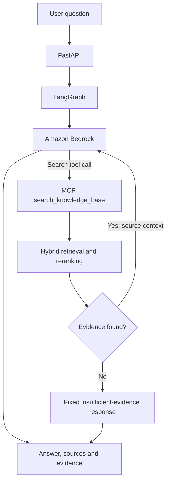

# RAG Ops Assistant

[](https://github.com/AZ1600/rag-ops-assistant/actions/workflows/tests.yml)

**An evidence-first operations documentation assistant** built with **FastAPI, LangGraph, Amazon Bedrock, MCP and hybrid retrieval**. It searches four curated cloud/platform engineering documentation snapshots and returns answers with source files, chunk references and retrieval scores.

**Start here:** [Technical review](#technical-review--start-here) · [Architecture](#architecture-and-safety-boundaries) · [Validation](#validation-and-evidence) · [Quick start](#quick-start--offline-tests) · [AWS evidence](#live-aws-verification) · [Limitations](#scope-and-limitations)

> [!IMPORTANT]
> This is a **portfolio/reference implementation**, not a live cloud-operations agent. It searches checked-in documentation, **does not inspect live infrastructure or execute remediation**, and currently has **no API-level authentication or rate limiting**. Its most recent temporary AWS test deployment was removed after verification.

## Technical review — start here

For a two-minute code review, follow these links before reading the full walkthrough:

| Engineering question | Implementation or evidence |
| --- | --- |
| How does a question reach the model and retrieval tool? | [LangGraph agent](src/langgraph_agent.py), [MCP server](src/mcp_server.py), [architecture](#architecture-and-safety-boundaries) |
| Where are documents indexed and ranked? | [Ingestion](src/ingest.py), [retrieval implementation](src/rag_core.py), [retrieval tests](tests/test_retrieval.py) |
| How are unknown facts and errors handled? | [Agent tests](tests/test_agent.py), [API error tests](tests/test_api_errors.py) |
| How is retrieval measured? | [Evaluation code](src/evaluate.py), [fixed cases](evals/retrieval_cases.json), [methodology](docs/retrieval-evaluation.md) |
| Has the system run on AWS? | [Deployment guide](docs/aws-deployment.md), [27 October 2026 live verification](docs/live-verification.md) |
| What is checked automatically? | [Offline test workflow](.github/workflows/tests.yml), [deployment workflow](.github/workflows/deploy.yml) |
| What remains unproven? | [Scope and limitations](#scope-and-limitations), [live citation-format finding](docs/live-verification.md#observed-limitation) |

### At a glance

| Verification | Recorded outcome | Interpretation |
| --- | --- | --- |
| Offline regression suite | **144 passed** (also reproduced locally on 30 October 2026) | Deterministic tests with controlled fakes; not a live Bedrock evaluation |
| Fixed retrieval evaluation | **32/32** | Source selection and abstention on development cases |
| Targeted retrieval probes | **12/12**, plus **12/12** terminology cases | Specific paraphrase and missing-fact scenarios |
| Live AWS smoke checks (27 October 2026) | **4 HTTP 200 responses** | Two supported answers with evidence, two fixed refusals |
| AWS temporary-stack cleanup | **18 resources destroyed; 0 active test infrastructure** | Checked after the temporary deployment; not evidence of an always-on service |

The evaluation cases helped guide development and are **not an independent held-out accuracy benchmark**. The live checks also revealed an inline citation-number mismatch, documented below.

## What it does

Ask questions about the four documented engineering systems, for example:

- “How does Private DNS help the VM reach Blob Storage?”
- “What are the five steps in a CloudOps Decision Trace, and can it execute a change?”
- “How do I move from a Loki error log to its matching distributed trace?”
- “Can a PlatformPilot viewer export findings to CloudOps?”

The assistant searches *curated snapshots*, not the current state of AWS, Azure, Kubernetes or customer systems. Its MCP server exposes one **read-only** tool: `search_knowledge_base`.

## Architecture and safety boundaries

| Component | Responsibility |
| --- | --- |
| FastAPI | Validate HTTP requests, expose `/health` and `/ask`, return structured responses |
| LangGraph | Maintain question state, route model/tool calls and stop after missing retrieval evidence |
| Amazon Bedrock / Nova | Select tools and generate responses |
| MCP | Expose the knowledge-base search tool over a persistent stdio connection |
| Retrieval | Chunk Markdown, combine semantic and lexical scores, rerank and preserve references |
| AWS delivery | Run a container on ECS Fargate with Terraform-managed infrastructure and GitHub OIDC |



General questions can receive a direct Bedrock answer. Documentation questions are instructed to use retrieval. If a search returns `found: false`, the graph stops before another generation call and returns a fixed abstention. Tool failures surface as service errors and a generic HTTP 500 response.

**Important boundary:** This guard works *after* the model chooses to search. It does not prove that every answer uses retrieval, is grounded, or has correctly aligned inline citations. No retrieved document or model output is authorized to change infrastructure.

### Engineering decisions

- **Traceable retrieval:** Section-aware Markdown chunking, stable chunk/source identifiers, semantic search with keyword overlap and cross-encoder reranking.
- **Unsupported facts:** Literal-value checks for recognized cloud identifiers and durations, plus fixed refusal when search finds no evidence.
- **Targeted terminology handling:** A narrowly scoped quiet-service → idle-application retry; not unrestricted query rewriting.
- **Reproducibility:** Fixed cases, corpus/index fingerprints, pinned dependency inputs and saved baseline/evaluation reports.
- **Cost-aware AWS validation:** Temporary deployment, health and query checks, then explicit cleanup rather than an always-running demonstration stack.
- **Separation of identity:** GitHub OIDC for deployment; distinct ECS execution and application task roles.

See [retrieval improvements](docs/retrieval-improvement.md), [terminology testing](docs/terminology-retrieval.md) and the [AWS deployment guide](docs/aws-deployment.md).

## Validation and evidence

Recorded validation through **27 October 2026** (with the unchanged **144-test baseline** reproduced locally on **30 October 2026**):

| Check | Result | What it measures |
| --- | ---: | --- |
| Deterministic offline tests | **144 passed** | Ingestion, retrieval, agent/tool behaviour, API errors, evaluation logic and controlled fakes |
| Fixed retrieval evaluation | **32/32** | Source selection and abstention: 20 supported, 4 ambiguous/cross-project, 8 unsupported |
| Existing targeted probes | **12/12** | Paraphrases and concept/value boundaries |
| Additional terminology cases | **12/12** | Supported wording and nearby unsupported/missing-fact questions |
| AWS live smoke checks | **4 HTTP 200** | Two supported evidence-bearing answers and two missing-fact refusals through the ALB |
| AWS cleanup checks | **18 destroyed; 0 active test infrastructure** | Temporary test-stack absence checks and preservation of existing network |

Exact reference coverage is a separate diagnostic: **17/24**, **7/9** and **6/6** answerable cases respectively. Matching source files is not equivalent to proving that every required fact appears in the returned evidence.

The fixed evaluation improved from **30/32 to 32/32** using the same fixed questions/documents. Existing probes improved from **11/12 to 12/12** following a terminology retry. Those cases informed development and must not be presented as independent model-answer accuracy. **CI runs offline fake-model tests**, not real Bedrock retrieval evaluations.

A live Private DNS answer included inline citations `[1]` and `[3]`, while returned evidence identified chunks `9`, `10` and `30`. The HTTP/source smoke check passed but **inline citation alignment did not**. This is an open quality limitation, not a passing citation-quality benchmark. See [observed limitation](docs/live-verification.md#observed-limitation).

Full methodology and artifacts: [Validation](docs/validation.md) · [Fixed evaluation](docs/retrieval-evaluation.md) · [Retrieval iteration](docs/retrieval-improvement.md) · [Terminology results](docs/terminology-retrieval.md) · [Saved latest model report](docs/terminology-main.json).

## Quick start — offline tests

Use **Python 3.11** (the version used for CI and recorded validation). Dependency installation needs network access; the installed test suite needs **no AWS account, credentials, model downloads or existing index**.

```bash
git clone https://github.com/AZ1600/rag-ops-assistant.git
cd rag-ops-assistant
python3.11 -m venv .venv
source .venv/bin/activate
python -m pip install -r requirements-dev.txt
python -m pytest -q --junitxml=test-results/pytest.xml
```

On Windows, activate the environment using `.venv\Scripts\activate` instead. Test fixtures prevent real network, AWS-client and model-loading paths. Read [coverage and test limitations](docs/validation.md).

## Run retrieval locally

The knowledge base consists of four **checked-in curated Markdown snapshots**:

| Snapshot | Coverage |
| --- | --- |
| [Azure infrastructure lab](data/az104-infrastructure-lab.md) | Private connectivity, DNS, storage and operational decisions |
| [CloudOps Command Center](data/cloudops-command-center.md) | Approval boundaries, Decision Traces and persistence |
| [Platform Engineering Observability](data/platform-engineering-observability.md) | Metrics, logs, traces, SLOs and no-traffic handling |
| [PlatformPilot](data/platform-pilot.md) | Findings, roles, identity and the CloudOps handoff |

They are *not* synchronized automatically with their source repositories.

Retrieval uses `all-MiniLM-L6-v2` embeddings with `cross-encoder/ms-marco-MiniLM-L-6-v2` reranking. The recorded index contained **194 chunks**. Hybrid ranking weighted semantic similarity at **75%** and keyword overlap at **25%**; up to eight candidates passed the configured `0.35` hybrid threshold. Up to three reranked results must pass `-1.0`. Cross-encoder outputs are relevance logits, **not calibrated probabilities**.

If the original reranker rejects every candidate, a curated alias can retry “quiet service/application/app” as “idle application” (including plurals), with the same candidates and threshold. This is a targeted exception, not general paraphrase handling.

Once the embedding/reranking models are cached, generate the index and evaluation reports without model downloads or Bedrock requests:

```bash
HF_HUB_OFFLINE=1 TRANSFORMERS_OFFLINE=1 HF_HUB_DISABLE_TELEMETRY=1 \
  python -m src.ingest
HF_HUB_OFFLINE=1 TRANSFORMERS_OFFLINE=1 HF_HUB_DISABLE_TELEMETRY=1 \
  python -m src.evaluate --offline --report eval-results/retrieval.json
HF_HUB_OFFLINE=1 TRANSFORMERS_OFFLINE=1 HF_HUB_DISABLE_TELEMETRY=1 \
  python -m src.evaluate --offline --cases evals/retrieval_probes.json \
  --report eval-results/retrieval-probes.json
HF_HUB_OFFLINE=1 TRANSFORMERS_OFFLINE=1 HF_HUB_DISABLE_TELEMETRY=1 \
  python -m src.evaluate --offline --cases evals/terminology_cases.json \
  --report eval-results/terminology.json
```

On a fresh machine, omit the offline flags if you intentionally want the models downloaded. Offline mode will fail if the models are absent. Neither evaluation command calls Bedrock. The evaluator exits nonzero if a source-selection/abstention case fails and records case/corpus/index fingerprints, versions and policies.

## Run the full assistant with Bedrock

The API/agent needs AWS credentials with permission to invoke the configured Bedrock model. **Each question can incur Bedrock charges**, including the first model call before an insufficient-evidence result. The current source sets region `eu-west-2` and model `global.amazon.nova-2-lite-v1:0` in [LangGraph configuration](src/langgraph_agent.py).

After building the index and choosing your locally configured AWS profile:

```bash
AWS_PROFILE=your-profile python -m uvicorn src.api:app --reload
```

Open [interactive API documentation](http://127.0.0.1:8000/docs) or call:

```bash
curl http://127.0.0.1:8000/health
curl -X POST http://127.0.0.1:8000/ask \
  -H 'Content-Type: application/json' \
  -d '{"question":"Will a quiet service show zero availability when nobody is using it?"}'
```

Illustrative response shape (scores and answer text vary by run):

```json
{
  "answer": "...",
  "sources": ["platform-engineering-observability.md"],
  "evidence": [
    {
      "chunk_number": 112,
      "source": "platform-engineering-observability.md",
      "hybrid_score": 0.38,
      "rerank_score": -0.01
    }
  ]
}
```

When search returns no evidence, the graph responds:

```json
{
  "answer": "The knowledge base does not contain sufficient information to answer that question.",
  "sources": [],
  "evidence": []
}
```

To use the interactive agent: `AWS_PROFILE=your-profile python -m src.langgraph_agent`.
To run only the retrieval MCP server: `python -m src.mcp_server`.
Its read-only tool returns `found`, `message`, `context`, `sources` and `evidence`.
Container instructions: [Run with Docker](docs/aws-deployment.md#run-with-docker).

## Live AWS verification

On **27 October 2026**, merged revision `6956bc2` was deployed into a **dedicated temporary Terraform stack**. Four live `/ask` requests returned HTTP 200: two included supported answers with evidence and two returned the fixed missing-fact refusal. CloudWatch recorded four MCP searches and six Bedrock-node calls. The test endpoint was removed after verification.

The [verification record](docs/live-verification.md) includes captured responses, source/image identifiers, model/tool trace and the cleanup checks.

### Healthy ECS task and ALB target


### Supported question with evidence

The quiet-service example returned documented no-traffic behaviour, with evidence pointing to chunk `112`.


### Missing fact refused

Undocumented production tenant-ID and retention-duration questions returned the fixed insufficient-evidence response.


### Cleanup verified

At **11:16 UTC** the temporary deployment reported zero managed resources and no running/pending tasks, load balancer, test repository, log group, security groups or network interfaces. Existing VPC/subnets were preserved. One task-definition registration remained as inactive/deregistered metadata. See the [cleanup record](docs/live-evidence/cleanup-summary.json).


Earlier ECR scanning, Terraform reconciliation, MCP integration and automated delivery evidence remain in the [AWS deployment guide](docs/aws-deployment.md).

## AWS deployment and CI/CD

The earlier validated AWS design used **Linux ARM64 ECS Fargate (1 vCPU, 2 GB RAM)** behind an ALB restricted to the owner's `/32` IP address. The task accepted traffic on port `8000` from the ALB security group. ECR stored the image, CloudWatch collected logs, Terraform managed infrastructure and GitHub Actions delivered image/task revisions.

[Tests workflow](.github/workflows/tests.yml): runs the deterministic suite for pull requests and `main` pushes using read-only repository permissions and uploads a JUnit artifact.

[Deployment workflow](.github/workflows/deploy.yml): automatic ECS deployment requires a successful `Tests` run on `main`, deployment-relevant changes and `ENABLE_AUTOMATIC_ECS_DEPLOY=true`. Documentation-only changes are outside the automatic deployment filter. The explicit manual **Run workflow** action on `main` requests deployment without waiting for a new test run; verify that revision's test status first.

CI settings do not guarantee that infrastructure is shut down or prevent cloud costs. Consult the [deployment guide](docs/aws-deployment.md) for Docker, IAM/OIDC, networking, Terraform, deploy steps and historical scan evidence.

## Scope and limitations

- **Knowledge scope:** Only four curated documentation snapshots. No live cloud state, current incidents, production identifiers or complete operational inventory.
- **Retrieval limits:** Targeted literal-value and terminology guards can miss unseen forms or incorrectly associate an existing fact with a requested system.
- **Answer quality:** Retrieval/flow evaluations are not a generated-answer accuracy benchmark. One observed live answer had mismatched inline citation numbering; prompt-injection resistance has not been measured.
- **API security:** No application authentication, authorization or rate limiting. The owner-restricted ALB was a personal validation deployment, not a public production security model.
- **Operations evidence:** The most recent temporary AWS stack was removed. Earlier image scans and automated deployment records are historical; the latest manual session did not rerun those workflows.
- **Cost:** Running Bedrock and AWS resources can incur charges; do not deploy without reviewing IAM, exposure and budget controls.

**Possible next improvements:** Verify inline citation numbers against evidence, add independent held-out question sets and generated-answer review, introduce API access controls, test prompt-injection robustness, measure retrieval latency, validate Terraform changes in PRs, and add production-grade release protections.

## Repository map

```text
src/                Ingestion, retrieval, MCP, LangGraph and FastAPI
data/               Four curated Markdown documentation snapshots
evals/              Fixed cases, targeted probes and terminology cases
tests/              Deterministic offline regression tests
docs/               Evaluation reports and AWS deployment evidence
deploy/ecs/         Example task definitions and IAM policies
infra/terraform/    Terraform resources and GitHub OIDC configuration
.github/workflows/  Offline testing and opt-in ECS deployment
```

Application dependencies: [requirements.txt](requirements.txt) · Test dependencies: [requirements-dev.txt](requirements-dev.txt). The Dockerfile installs CPU-only PyTorch separately. Generated indexes, local evaluation output, test results, credentials and Terraform state are not intended for version control.

## Author

**Olawale Azeez**

AWS Certified Developer – Associate · AWS Certified Solutions Architect – Associate · AWS Certified Cloud Practitioner

[GitHub profile](https://github.com/AZ1600) · [Engineering portfolio](https://az1600.github.io/)
