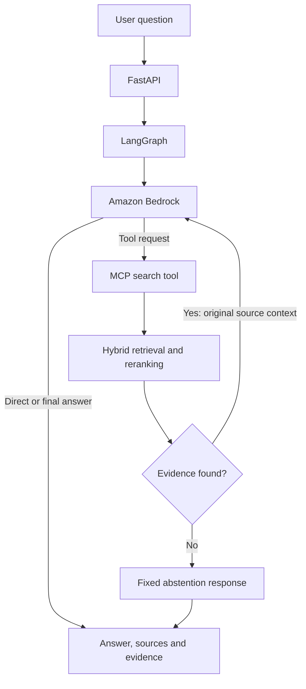

# RAG Ops Assistant

[](https://github.com/AZ1600/rag-ops-assistant/actions/workflows/tests.yml)
[AWS deployment evidence](docs/aws-deployment.md) · [Validation details](docs/validation.md)

An operations documentation assistant built with **RAG, Amazon Bedrock, MCP,
LangGraph and FastAPI**. It retrieves evidence from four engineering project
snapshots and returns an answer with source files, chunk references and retrieval
scores.

The project has been **deployed and tested on AWS ECS Fargate** using an ARM64
container, an Application Load Balancer, IAM task roles, ECR, CloudWatch,
Terraform and GitHub Actions with OIDC. The [AWS guide](docs/aws-deployment.md)
preserves the original cloud delivery work.

On **27 October 2026**, merged runtime revision `6956bc2` was deployed again using
a dedicated temporary Terraform stack. Four live `/ask` requests returned HTTP
200: two supported answers included source evidence, and two missing-fact
questions returned the fixed refusal. CloudWatch recorded four MCP searches and
six Bedrock-node calls. **All 18 test resources were then destroyed**, with
cleanup independently checked through AWS APIs and local state. The test endpoint
was removed after verification. [Results, screenshots and limits](docs/live-verification.md).

## What it does

Use the assistant to ask how a documented system works, such as:

- “How does Private DNS help the VM reach Blob Storage?”
- “What are the five steps in a CloudOps Decision Trace, and can it execute a change?”
- “How do I move from a Loki error log to its matching distributed trace?”
- “Can a PlatformPilot viewer export findings to CloudOps?”

It searches documentation snapshots. It does not query live cloud resources,
inspect current incidents or execute remediation. The MCP server exposes one
read-only tool: `search_knowledge_base`.

## How the pieces fit

| Layer | Responsibility |
| --- | --- |
| FastAPI | HTTP request validation, `/health`, `/ask` and structured responses |
| LangGraph | Question state, model/tool routing and the no-evidence stopping rule |
| Bedrock / Nova | Choose tools and generate the response |
| MCP | Discover and call the knowledge-base search tool over a persistent stdio connection |
| Retrieval | Select document chunks using embeddings, keyword overlap and reranking |
| AWS delivery | Run the container on Fargate with Terraform-managed infrastructure and OIDC deployment authentication |



General questions can receive a direct Bedrock answer. Documentation questions
are instructed to use retrieval. When the search tool returns `found: false`,
LangGraph stops before a further generation call and returns a fixed abstention.
A tool failure raises a service error and produces a generic HTTP 500 response.
The guard applies after a search; it does not prove that every model response
is grounded or that the model always chooses the tool correctly.

## Demonstrated engineering work

- **Evidence retrieval:** section-aware Markdown chunking with repeated headings,
  hybrid scoring, cross-encoder reranking and stable source/chunk metadata.
- **Missing-fact handling:** literal-value checks for recognized cloud-ID and
  duration requests, plus the graph's no-evidence stopping rule.
- **Measured iteration:** preserved baseline reports, fixed questions and corpus
  fingerprints, targeted probes and documented remaining limits.
- **Cloud delivery:** an ARM64 CPU-only image, ECR scanning, separate ECS execution
  and application roles, ALB routing, CloudWatch logs and Terraform reconciliation.
- **Deployment identity:** GitHub OIDC with temporary AWS credentials,
  commit-SHA image tags and ECS service/target-health checks.

The earlier cloud query and deployment evidence remain in the
[AWS guide](docs/aws-deployment.md#end-to-end-aws-rag-query).

## Validation results

Recorded local validation after the retrieval updates, through **27 October 2026**:

| Check | Result | What it measures |
| --- | ---: | --- |
| Deterministic offline tests | **144 passed** | Retrieval, ingestion, tool/graph behaviour, API errors, labels and evaluator reporting with controlled fakes |
| Fixed retrieval evaluation | **32/32** | Source selection and abstention across 20 supported, 4 ambiguous/cross-project and 8 unsupported questions |
| Existing targeted probes | **12/12** | Paraphrases and concept/value boundaries |
| Additional terminology cases | **12/12** | Supported wording and six nearby missing-fact questions |
| Live AWS smoke checks | **4 HTTP 200 responses** | Two supported responses with evidence and two fixed refusals through the ALB |
| Temporary-stack cleanup | **18 destroyed; 0 active test infrastructure** | AWS absence checks, zero managed state and preserved existing network |

Exact reference coverage is a separate diagnostic: **17/24**, **7/9** and **6/6**
answerable cases respectively. A matching filename alone can miss a required
fact; equivalent wording can also miss an exact reference quote.

The fixed evaluation improved from **30/32 to 32/32** without changing its
questions or documents. The existing probes improved from **11/12 to 12/12**
after a narrow terminology retry. These development cases informed the changes;
these numbers are **not independent held-out accuracy or generated-answer quality**.
CI runs fake-model tests, not the real-model retrieval evaluations.

The live Private DNS response exposed a citation-format limitation: it used
`[1]` and `[3]` while the returned evidence listed chunks `9`, `10` and `30`.
Its HTTP/source check passed; exact inline citation alignment did not. The live
smoke checks are not a generated-answer accuracy benchmark. See the
[recorded limitation](docs/live-verification.md#observed-limitation).

See the [scoring rubric and baseline](docs/retrieval-evaluation.md),
[section retrieval comparison](docs/retrieval-improvement.md),
[terminology results](docs/terminology-retrieval.md) and
[latest model report](docs/terminology-main.json).

## Quick start: offline tests

Use **Python 3.11**, the version used for recorded validation and CI.
Dependency installation needs package-network access. Once installed, the tests
require no AWS account, cloud credentials, model downloads or ingested index.

```bash
git clone https://github.com/AZ1600/rag-ops-assistant.git
cd rag-ops-assistant
python3.11 -m venv .venv
source .venv/bin/activate
python -m pip install -r requirements-dev.txt
python -m pytest -q --junitxml=test-results/pytest.xml
```

The test fixtures block network connections, AWS client construction and real
model loading. See [test coverage and limits](docs/validation.md).

## Run retrieval locally

The knowledge base contains four checked-in Markdown snapshots:

| Snapshot | Coverage |
| --- | --- |
| [Azure infrastructure lab](data/az104-infrastructure-lab.md) | Private connectivity, DNS, storage access and operational decisions |
| [CloudOps Command Center](data/cloudops-command-center.md) | Remediation safety, decision traces and persistence |
| [Platform Engineering Observability](data/platform-engineering-observability.md) | Metrics, logs, traces, SLOs and no-traffic handling |
| [PlatformPilot](data/platform-pilot.md) | Operational findings, roles, identity and handoff to CloudOps |

These files are curated snapshots, not automatic mirrors of the source projects.

Retrieval uses `all-MiniLM-L6-v2` embeddings and
`cross-encoder/ms-marco-MiniLM-L-6-v2` reranking. The ignored NumPy/JSON index
contains **194 chunks** in the recorded run. Hybrid scores combine 75% semantic
similarity and 25% keyword overlap, admitting up to 8 candidates above `0.35`.
The literal-value guards run before reranking; up to 3 results must pass `-1.0`.
Those cross-encoder scores are relevance logits, not probabilities.

When the original reranker rejects every candidate, one curated alias can retry
“quiet service/application/app” as “idle application”, including plurals. It
reuses the same candidates and cutoff and preserves the original evidence.
This targeted retry does not implement general query rewriting.

With both models already cached, build the index and run the three evaluations
without model downloads or Bedrock calls:

```bash
HF_HUB_OFFLINE=1 TRANSFORMERS_OFFLINE=1 HF_HUB_DISABLE_TELEMETRY=1 \
  python -m src.ingest
HF_HUB_OFFLINE=1 TRANSFORMERS_OFFLINE=1 HF_HUB_DISABLE_TELEMETRY=1 \
  python -m src.evaluate --offline --report eval-results/retrieval.json
HF_HUB_OFFLINE=1 TRANSFORMERS_OFFLINE=1 HF_HUB_DISABLE_TELEMETRY=1 \
  python -m src.evaluate --offline --cases evals/retrieval_probes.json \
  --report eval-results/retrieval-probes.json
HF_HUB_OFFLINE=1 TRANSFORMERS_OFFLINE=1 HF_HUB_DISABLE_TELEMETRY=1 \
  python -m src.evaluate --offline --cases evals/terminology_cases.json \
  --report eval-results/terminology.json
```

On a fresh machine, `python -m src.ingest` and `python -m src.evaluate` can download
the embedding and reranker models. Offline flags intentionally fail if a required
model is not cached. Neither evaluation mode invokes Bedrock. Existing section
indexes can be reused; older chunking metadata stops with a rebuild command.

Evaluation exits `0` when every source-selection/abstention case passes and `1`
when any fails, saving the requested report in either case. Reports record case,
corpus and index fingerprints, model/library versions and retrieval policies.

## Run the full assistant with Bedrock

The full agent/API additionally needs an AWS profile permitted to invoke the
configured Bedrock model. **Agent questions make Bedrock calls and can incur
charges**, including the initial model call before a no-evidence result.
The source currently selects region `eu-west-2` and model
`global.amazon.nova-2-lite-v1:0` in [the agent configuration](src/langgraph_agent.py).

With the environment active and the index ready, replace `your-profile` with your
local profile name:

```bash
AWS_PROFILE=your-profile python -m uvicorn src.api:app --reload
```

The service starts MCP, discovers tools and reuses the compiled graph/connection
across questions. Open [interactive API docs](http://127.0.0.1:8000/docs), or use:

```bash
curl http://127.0.0.1:8000/health
curl -X POST http://127.0.0.1:8000/ask \
  -H 'Content-Type: application/json' \
  -d '{"question":"Will a quiet service show zero availability when nobody is using it?"}'
```

Illustrative response shape; answer text and scores depend on the run:

```json
{
  "answer": "...",
  "sources": ["platform-engineering-observability.md"],
  "evidence": [{
    "chunk_number": 112,
    "source": "platform-engineering-observability.md",
    "hybrid_score": 0.38,
    "rerank_score": -0.01
  }]
}
```

When the search reports no evidence, the graph returns:

```json
{
  "answer": "The knowledge base does not contain sufficient information to answer that question.",
  "sources": [],
  "evidence": []
}
```

For the interactive agent, run `AWS_PROFILE=your-profile python -m src.langgraph_agent`.
To start only the retrieval MCP server, run `python -m src.mcp_server`; its
`search_knowledge_base` tool returns `found`, `message`, `context`, `sources` and
`evidence`. Docker instructions are in the [AWS/container guide](docs/aws-deployment.md#run-with-docker).

## Live AWS evidence

The following screenshots record the **27 October 2026 temporary deployment**.
The [verification record](docs/live-verification.md) includes exact source/image
identifiers, captured responses, the model/tool trace and cleanup checks.

### Healthy ECS task and load-balancer target


### Supported question with retrieved evidence

The quiet-service question returned the documented no-traffic behaviour and cited
chunk `112`. The exact question reached the MCP tool unchanged.


### Missing fact refused

The request for an undocumented production tenant ID returned the fixed refusal
with empty sources and evidence. A missing retention duration was also refused.


### Cleanup verified

At `11:16 UTC`, the test had zero managed resources, no running/pending tasks,
no load balancer, repository, log group, test security groups or network
interfaces. Existing VPC/subnets were preserved. One inactive task-definition
registration remained as deregistered metadata. [Cleanup record](docs/live-evidence/cleanup-summary.json).


The earlier API demo, MCP flow, ARM64 image optimization, ECR scan, Terraform
reconciliation and automated deployment are preserved in the
[AWS deployment guide](docs/aws-deployment.md).

## AWS deployment and CI/CD

The previously validated deployment used **Linux ARM64 Fargate, 1 vCPU and 2 GB
memory**, behind an ALB restricted to the owner's `/32` address. The task accepted
port `8000` from the ALB security group. ECR held the image and CloudWatch collected
container logs. Terraform managed the long-lived infrastructure; GitHub Actions
managed application image and task-definition revisions.

GitHub Actions runs the offline suite on pull requests and pushes to `main`,
with read-only repository permissions and a JUnit artifact. Automatic deployment
requires a successful `Tests` run on `main`, deployment-relevant changes and
`ENABLE_AUTOMATIC_ECS_DEPLOY` set to exactly `true`. Leaving it unset or `false`
keeps automatic deployment disabled. Documentation-only changes are outside the
workflow's automatic deployment file filter.

A manual **Run workflow** on `main` is an explicit deployment request and does
not wait for a new test run. Check the selected revision's Tests first. Deployment
gating does not stop running AWS resources or determine their current costs.

Read the [AWS deployment guide and recorded evidence](docs/aws-deployment.md) for
architecture, Docker, IAM/OIDC, networking, Terraform, deployment stages, earlier
image scan results and service/ALB screenshots.

## Scope and limitations

- **Evidence scope:** the corpus is four project snapshots. It does not contain
  live production IDs, current queue counts or a complete operations knowledge base.
- **Retrieval:** the curated alias and literal-value guards recognize limited
  wording/formats. A value's presence does not establish that it belongs to the
  requested production system. Unseen paraphrases can still fail.
- **Generation:** local evaluations measure retrieval and control flow. Four
  live examples do not establish answer accuracy; the Private DNS inline citation
  mismatch is recorded. Prompt-injection resistance was not measured.
- **API exposure:** the API has no application authentication, authorization or
  rate limiting. The documented owner-restricted ALB was a personal deployment.
- **Deployment evidence:** the latest temporary stack was removed after its
  checks. Earlier scan results and automated delivery evidence are historical;
  this manual session did not rerun GitHub Actions deployment or image scanning.

Possible next work includes inline citation validation, independent evaluation
cases, generated-answer assessment, API access controls, prompt-injection testing, retrieval latency
measurement, Terraform PR validation and production deployment protections.

## Repository map

```text
src/                Retrieval, ingestion, MCP, LangGraph and FastAPI
data/               Four documentation snapshots
evals/              Fixed cases, targeted probes and terminology cases
tests/              Deterministic offline regression suite
docs/               Evaluation reports, explanations and deployment evidence
deploy/ecs/         Example task definitions and IAM policies
infra/terraform/    AWS infrastructure and GitHub OIDC configuration
.github/workflows/  Tests and opt-in ECS deployment
```

Pinned application dependencies are in [requirements.txt](requirements.txt);
test dependencies are in [requirements-dev.txt](requirements-dev.txt).
The Dockerfile installs CPU-only PyTorch separately. Generated `index/`, local
`eval-results/`, test artifacts, credentials and Terraform state are not intended
as source-controlled project files.

## Author

**Olawale Azeez**

AWS Certified Developer – Associate · AWS Certified Solutions Architect – Associate ·
AWS Certified Cloud Practitioner
