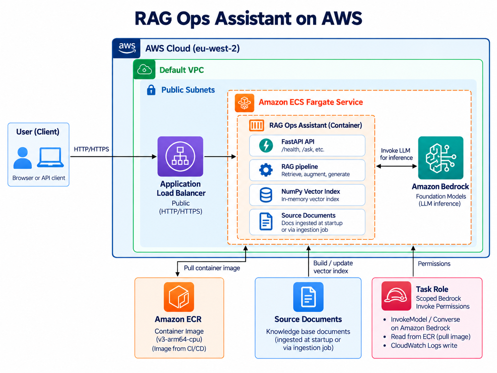
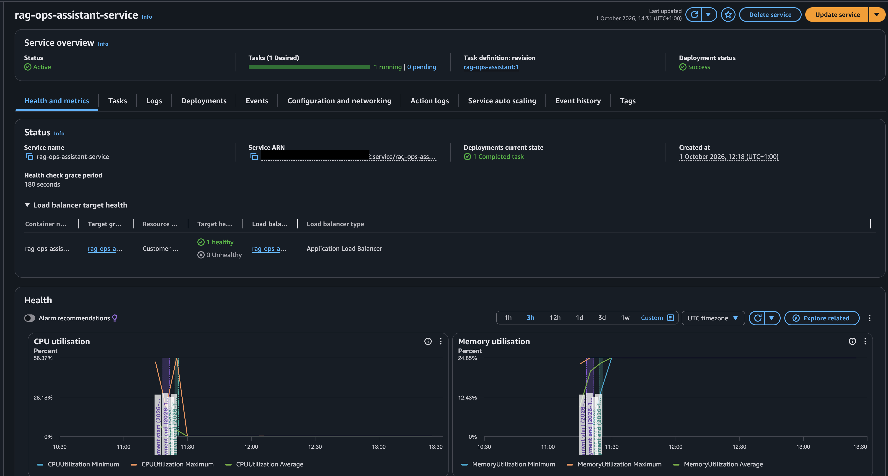
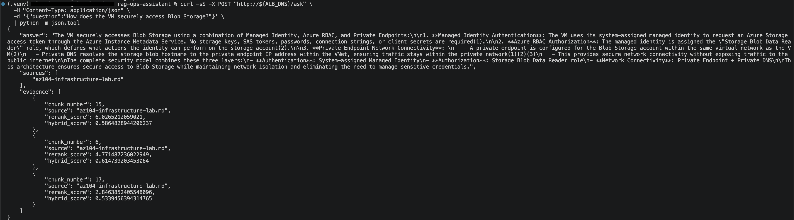
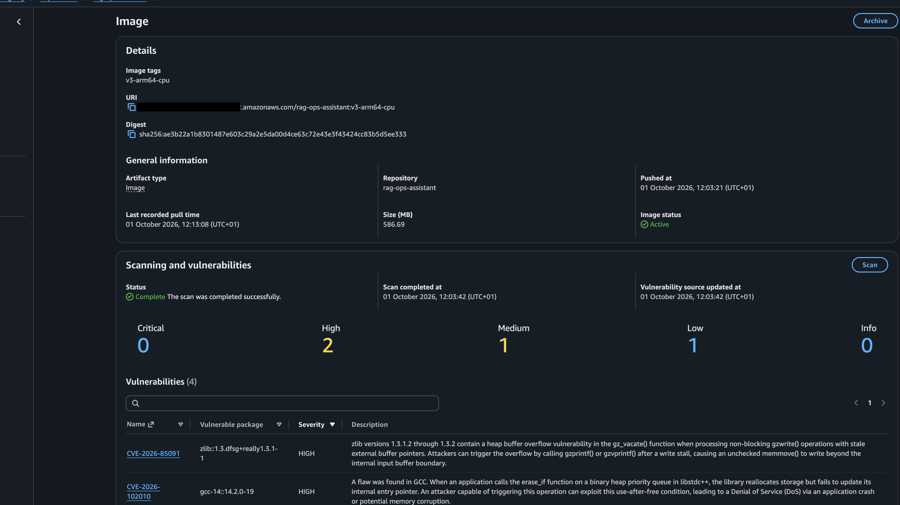

# AWS deployment guide and evidence

[Back to the project overview](../README.md)

RAG Ops Assistant was previously deployed and tested on AWS ECS Fargate in
`eu-west-2`. The recorded evidence includes an ARM64 container, an end-to-end
`/ask` request through the Application Load Balancer, ECR scanning, CloudWatch
logging, IAM task roles, Terraform reconciliation and a GitHub Actions deployment
using OIDC. These are demonstrated project achievements.

This guide preserves the original deployment detail and automated delivery
evidence. A fresh **manual temporary deployment on 27 October 2026** tested
runtime revision `6956bc2`, then removed all 18 managed resources and verified
cleanup. See the [live verification record](live-verification.md) for its four
API examples, screenshots, trace and observed citation-format limitation.

The older image sizes, vulnerability counts, automated deployment and zero-drift
output below describe earlier runs. They do not establish a current scan or drift
result. The fresh test used isolated temporary Terraform state and did not rerun
the GitHub Actions/OIDC deployment workflow. No live test endpoint remains after
cleanup.

Commands are run from the repository root. Docker builds need dependency/model
downloads; API queries use Bedrock. Terraform plans and deployment commands access
AWS. Provisioned resources and model use can incur charges. Repository files
alone do not establish which resources are currently running.

## Contents

- [Recorded architecture](#architecture)
- [AWS deployment and ECS service](#aws-deployment)
- [End-to-end request evidence](#end-to-end-aws-rag-query)
- [Container image and recorded security scan](#container-security-and-optimisation)
- [Run with Docker](#run-with-docker)
- [Networking and security](#networking-and-security)
- [Terraform and ownership](#infrastructure-as-code)
- [Deployment gate and workflow](#continuous-deployment)
- [GitHub OIDC](#github-oidc-authentication)
- [Earlier automated deployment](#verified-automated-deployment)

## Architecture

<p align="center">
  
</p>

The previously validated infrastructure path was:

```text
Owner client (/32 allowed)
    -> Application Load Balancer
    -> ECS service / ARM64 Fargate task
    -> FastAPI / LangGraph / MCP retrieval
```

Bedrock makes the initial tool-selection call and, when evidence is found,
generates the final answer. See the [application request flow](../README.md#how-the-pieces-fit)
for the model/tool loop and no-evidence branch.

Supporting AWS services include:

```text
Amazon ECR
    |
    | container image
    v
ECS Fargate

Fargate
    |
    | logs
    v
CloudWatch Logs

Fargate
    |
    | temporary AWS credentials
    v
ECS Task IAM Role
    |
    v
Amazon Bedrock
```

---

## CI/CD Architecture

GitHub Actions runs offline tests on pull requests and pushes to `main`. AWS deployment is a separate, opt-in action: automatic deployment requires the repository variable `ENABLE_AUTOMATIC_ECS_DEPLOY` to equal `true`. With the variable absent or set to `false`, use a deliberate manual workflow run on `main` when a deployment is wanted.

```text
Pull Request
    |
    v
GitHub Actions
Tests
    |
    | merge to main
    | tests pass + automatic deployment explicitly enabled
    | (or a manual deployment run on main)
    v
Deploy to AWS ECS
    |
    v
GitHub OIDC
    |
    v
AWS STS
    |
    v
Short-Lived AWS Credentials
    |
    +-------------------------+
    |                         |
    v                         v
Build ARM64 Image         Amazon ECR
    |                         |
    +------------+------------+
                 |
                 v
        ECS Task Definition
                 |
                 v
          ECS Fargate Service
                 |
                 v
       Wait for Service Stable
                 |
                 v
      Verify ALB Target Health
```

The documented deployment authentication uses OIDC rather than long-lived AWS keys.

---

## AWS Deployment

The application was deployed in **AWS eu-west-2** using Amazon ECS on AWS Fargate.

The documented deployment configuration used:

- Linux ARM64 Fargate task
- 1 vCPU
- 2 GB memory
- FastAPI listening on container port `8000`
- Amazon ECR container registry
- Application Load Balancer
- ALB health checks
- CloudWatch container logging
- separate ECS execution and application task IAM roles
- scoped Amazon Bedrock permissions
- security-group isolation between the ALB and Fargate task
- Terraform-managed infrastructure
- opt-in GitHub Actions deployments
- GitHub OIDC authentication to AWS

The documented environment was a personal project deployment.

The documented Application Load Balancer was restricted to the owner's public `/32` address.

The documented Fargate task ran in a public subnet with a public IP assigned; its security group restricted direct inbound access.

Port `8000` accepts traffic only from the ALB security group.

---

## ECS Fargate Service

The application ran as an ECS service behind an Application Load Balancer.

<p align="center">
  
</p>

The recorded service configuration used:

```text
Operating system: Linux
CPU architecture: ARM64
CPU:              1024 units / 1 vCPU
Memory:           2048 MiB
Container port:   8000
Desired tasks:    1
```

The Application Load Balancer performs health checks against:

```text
GET /health
```

The task security group accepts port `8000` traffic only from the ALB security group.

---

## End-to-End AWS RAG Query

For the latest test, see [27 October live API results](live-verification.md). The screenshot below records the earlier deployment.

The `/ask` endpoint has been tested through the Application Load Balancer rather than directly against the container.

<p align="center">
  
</p>

The recorded response contained:

- a grounded model-generated answer
- source document names
- retrieved chunk numbers
- hybrid retrieval scores
- cross-encoder reranking scores

That run validated the complete cloud path:

```text
Client
  |
  v
Application Load Balancer
  |
  v
ECS Fargate
  |
  v
FastAPI
  |
  v
LangGraph
  |
  v
MCP Tool
  |
  v
RAG Retrieval
  |
  v
Amazon Bedrock
  |
  v
Grounded Response
```

Amazon Bedrock is accessed from Fargate using the ECS task IAM role rather than mounted local credentials.

---

## Container Security and Optimisation

The first Docker build pulled the default PyTorch dependency stack, including large CUDA/NVIDIA libraries that were unnecessary for an ARM64 CPU-only Fargate workload.

The original image was approximately:

```text
Local Docker image: ~9.94 GB
ECR compressed size: ~3.5 GB
```

Inspection showed several gigabytes were consumed by:

```text
nvidia
triton
torch
```

The image was rebuilt using **CPU-only PyTorch for ARM64**, removing the unused NVIDIA/CUDA stack.

The recorded optimized deployment image was approximately:

```text
ECR image size: ~586 MB
Architecture:   arm64/linux
PyTorch:        CPU only
CUDA:           disabled
```

The image also:

- uses `python:3.11-slim-trixie`
- installs current Debian security package updates during the build
- builds the RAG index into the container
- caches the embedding model
- caches the cross-encoder reranker
- avoids Docker provenance/attestation for the single-platform deployment image

### ECR Security Scan

<p align="center">
  
</p>

The documented deployment image scan completed with:

```text
Critical: 0
High:     2
Medium:   1
Low:      1
```

The remaining high-severity findings in that recorded scan were reviewed as operating-system package findings.

They were tracked rather than force-patched using packages outside the configured Debian repositories.

---

## Run with Docker

The application can run locally as a Docker container.

The production-oriented image:

- uses Python 3.11 on Debian Trixie
- targets ARM64/Linux
- uses CPU-only PyTorch
- installs application dependencies
- applies selected Debian security updates
- copies the application and knowledge-base documents
- builds the RAG index
- caches the embedding model
- caches the reranker model
- starts FastAPI on port `8000`

### Build the Image

```bash
docker build \
  --platform linux/arm64 \
  --provenance=false \
  -t rag-ops-assistant:latest .
```

The explicit platform targets the documented ARM64 runtime. Non-ARM64 builders
need support for building that platform. This documentation update does not
include a new container build.

Verify the architecture:

```bash
docker image inspect rag-ops-assistant:latest \
  --format '{{.Architecture}}/{{.Os}}'
```

Expected:

```text
arm64/linux
```

### Run Locally with AWS Credentials

For local Docker testing only, mount the AWS credentials directory read-only:

```bash
docker run --rm \
  -p 8001:8000 \
  -e AWS_PROFILE=your-profile \
  -v "$HOME/.aws:/root/.aws:ro" \
  rag-ops-assistant:latest
```

Then test:

```bash
curl http://127.0.0.1:8001/health
```

and:

```bash
curl -X POST http://127.0.0.1:8001/ask \
  -H "Content-Type: application/json" \
  -d '{"question":"How does the VM securely access Blob Storage?"}'
```

### AWS Credentials on ECS

AWS credentials are **not mounted into the ECS container** and are not baked into the image.

Boto3 automatically receives temporary credentials from the ECS task role:

```text
Fargate Task
     |
     v
ECS Task Role
     |
     v
Temporary AWS Credentials
     |
     v
Amazon Bedrock
```

This removes the need to store static AWS access keys inside the deployed container.

---

## Amazon ECR

The documented optimized ARM64 image was pushed to Amazon ECR.

Automated deployments use the Git commit SHA as the image tag:

```text
rag-ops-assistant:<commit-sha>
```

This creates a direct relationship between:

```text
Git commit
    |
    v
ECR image
    |
    v
ECS task-definition revision
    |
    v
Running deployment
```

This also makes deployment history and rollback candidates easier to identify.

The Terraform repository configuration enables ECR scan-on-push.

---

## ECS Deployment Configuration

Reusable example deployment files are stored under:

```text
deploy/ecs/
```

The examples use placeholders such as:

```text
<AWS_ACCOUNT_ID>
<AWS_REGION>
```

rather than publishing account-specific values.

### ECS Task Definition

The task definition uses:

```text
Launch type:        FARGATE
Operating system:   LINUX
CPU architecture:   ARM64
CPU:                1024
Memory:             2048 MiB
Network mode:       awsvpc
Container port:     8000
```

### Runtime IAM Roles

Two different runtime roles are used.

```text
ECS Execution Role
    |
    +--> Pull image from ECR
    |
    +--> Write logs to CloudWatch


ECS Task Role
    |
    +--> Invoke Amazon Bedrock
```

This separates infrastructure permissions from application permissions.

---

## Networking and Security

The documented personal deployment used an internet-facing Application Load Balancer.

Traffic is restricted as follows:

```text
Owner public IP /32
        |
        | HTTP :80
        v
Application Load Balancer
        |
        | TCP :8000
        v
Fargate Task
```

The ALB security group accepts HTTP only from the owner's current `/32` address.

The task security group accepts TCP port `8000` only from the ALB security group.

In that configuration, the task security group did not permit direct internet access despite its assigned public IP.

For a larger production deployment, the task could be moved into private subnets and outbound dependencies handled through NAT or VPC endpoints.

---

## CloudWatch Logging

The Fargate container uses the `awslogs` log driver.

Logs are written to:

```text
/ecs/rag-ops-assistant
```

This provides centralized visibility into:

- application startup
- MCP initialization
- Bedrock calls
- agent errors
- container failures

---

## Infrastructure as Code

The AWS deployment is managed with **Terraform**.

Terraform configuration is stored under:

```text
infra/terraform/
```

Terraform manages:

- Amazon ECR repository
- ECS cluster
- ECS service configuration
- bootstrap ECS task definition
- ECS execution role
- ECS application task role
- scoped Amazon Bedrock permissions
- CloudWatch log group
- Application Load Balancer
- ALB listener
- target group
- ALB security group
- Fargate task security group
- GitHub Actions OIDC provider
- GitHub Actions deployment IAM role
- GitHub Actions deployment IAM policy

The default VPC and existing subnets have Terraform data sources. The checked-in
ECS service currently selects a specific subnet ID in `infra/terraform/ecs.tf`;
review that account-specific selection before reusing the configuration in
another account or region. This documentation update does not change it.

### Terraform Structure

```text
infra/terraform/
├── .terraform.lock.hcl
├── alb.tf
├── data.tf
├── ecr.tf
├── ecs.tf
├── github-actions.tf
├── iam.tf
├── logs.tf
├── outputs.tf
├── providers.tf
├── security-groups.tf
├── terraform.tfvars.example
├── variables.tf
└── versions.tf
```

### Terraform and CI/CD Ownership

Terraform owns the long-lived infrastructure configuration.

GitHub Actions owns application image deployment revisions.

```text
Terraform
  |
  +--> ECR repository
  +--> IAM
  +--> ALB / target group / listener
  +--> security groups
  +--> ECS cluster
  +--> ECS service configuration
  +--> CloudWatch
  +--> GitHub OIDC infrastructure


GitHub Actions
  |
  +--> build application image
  +--> push commit-SHA image to ECR
  +--> register new task-definition revision
  +--> update ECS service
```

Terraform ignores CI-managed task-definition image revisions so a later infrastructure plan does not roll the running application back to an older image.

### Local Terraform Usage

Create a local variables file:

```bash
cp infra/terraform/terraform.tfvars.example \
   infra/terraform/terraform.tfvars
```

Update it with your AWS profile and the CIDR allowed to reach the personal-project ALB:

```hcl
aws_region       = "eu-west-2"
aws_profile      = "<your-aws-profile>"
alb_allowed_cidr = "<YOUR_PUBLIC_IP>/32"
```

The real `terraform.tfvars` file and Terraform state files are intentionally excluded from Git.

Initialize Terraform:

```bash
terraform -chdir=infra/terraform init
```

Format and validate:

```bash
terraform -chdir=infra/terraform fmt -check
terraform -chdir=infra/terraform validate
```

Preview infrastructure changes:

```bash
terraform -chdir=infra/terraform plan
```

The existing AWS deployment was imported into Terraform state and reconciled with the configuration.

The earlier recorded zero-drift verification produced:

```text
No changes. Your infrastructure matches the configuration.
```

---

## Continuous Deployment

The deployment workflow is stored at:

```text
.github/workflows/deploy.yml
```

Automatic deployment is **disabled by default**. A successful `Tests` run on `main`
can start deployment only when the repository Actions variable
`ENABLE_AUTOMATIC_ECS_DEPLOY` is exactly `true` and deployment-relevant files changed.
Leave this variable unset or `false` while working on offline validation.

The existing **Run workflow** action remains available on `main`; it is an explicit
AWS deployment request and does not wait for a new test run. Confirm that the
selected `main` revision has passed Tests before using it. This gate does not
stop existing AWS resources or change their running costs.

The pipeline performs:

```text
Tests succeed on main + automatic deployment enabled
(or an explicit manual run on main)
        |
        v
Resolve deployment SHA
        |
        v
Checkout exact revision
        |
        v
Authenticate to AWS through OIDC
        |
        v
Verify AWS identity
        |
        v
Log in to Amazon ECR
        |
        v
Build native ARM64 image
        |
        v
Push commit-SHA image
        |
        v
Download current ECS task definition
        |
        v
Render new image into task definition
        |
        v
Register new task-definition revision
        |
        v
Update ECS service
        |
        v
Wait for service stability
        |
        v
Verify ALB target health
```

The workflow uses a native ARM64 GitHub-hosted runner, matching the Fargate runtime architecture.

---

## GitHub OIDC Authentication

The deployment workflow does **not** use stored AWS access keys.

Authentication works as follows:

```text
GitHub Actions
      |
      | OIDC token
      v
AWS STS
      |
      | temporary credentials
      v
GitHub Deployment IAM Role
      |
      +--> ECR
      +--> ECS
      +--> IAM PassRole
      +--> ALB target-health reads
```

The OIDC trust relationship is restricted to this repository's `main` branch.

The deployment role is limited to the permissions required by the pipeline:

- obtain an ECR authorization token
- push images to the project ECR repository
- describe and register ECS task definitions
- describe and update the ECS service
- pass only the ECS execution and task roles
- read ALB target-group and target-health information

The deployment workflow references this GitHub secret:

```text
AWS_DEPLOY_ROLE_ARN
```

The deployment workflow uses OIDC rather than a long-lived AWS access-key secret.

Because the ALB is restricted to the owner's `/32`, the GitHub-hosted runner validates deployment health through the AWS ELB target-health API rather than directly accessing the ALB URL.

---

## Verified Automated Deployment

The first end-to-end automated deployment previously completed successfully. The evidence below documents that earlier run; it is not a new live deployment check. Automatic deployment now requires the opt-in variable described above.

The following GitHub Actions stages passed:

```text
Resolve deployment SHA             ✅
Checkout deployed revision         ✅
Configure AWS credentials          ✅
Verify AWS identity                ✅
Log in to Amazon ECR               ✅
Build and push ARM64 image         ✅
Download current task definition   ✅
Render new image                   ✅
Deploy ECS task definition         ✅
Verify ALB target health           ✅
```

That earlier run validated the complete delivery path:

```text
Git commit
    |
    v
GitHub Actions Tests
    |
    v
GitHub OIDC
    |
    v
AWS
    |
    v
ARM64 Docker Build
    |
    v
Amazon ECR
    |
    v
New ECS Task Revision
    |
    v
Fargate Rolling Deployment
    |
    v
Healthy ALB Target
```

---

## Security Notes

Deployment examples use placeholders; local account values and Terraform state are excluded from Git.

The ECS application uses temporary IAM task-role credentials provided dynamically by AWS.

The GitHub Actions deployment pipeline uses GitHub OIDC and AWS STS to obtain short-lived deployment credentials.

The documented GitHub Actions configuration uses OIDC for deployment authentication.

Use local variables for deployment-specific values, and review the existing
Terraform configuration for account-specific defaults before reuse.

The example files under:

```text
deploy/ecs/
```

use placeholders for values such as:

```text
<AWS_ACCOUNT_ID>
<AWS_REGION>
```

The following Terraform files are intentionally excluded from Git:

```text
terraform.tfvars
*.tfstate
*.tfstate.*
.terraform/
*.tfplan
```

The Terraform provider lock file is committed:

```text
infra/terraform/.terraform.lock.hcl
```

Screenshots used in this README redact account identifiers, public IP addresses, and other deployment-specific values where appropriate.

---
