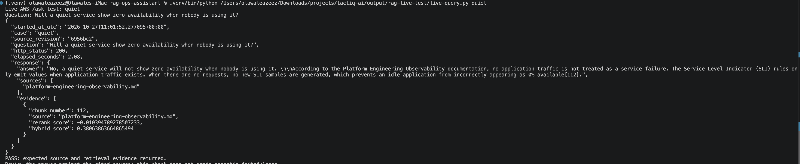
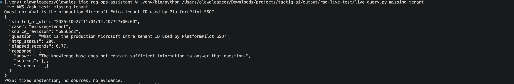
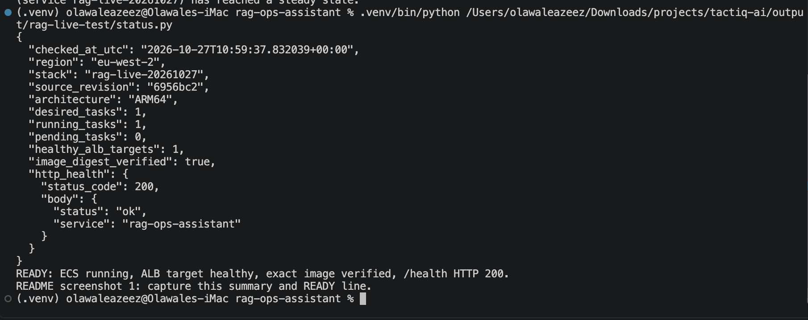
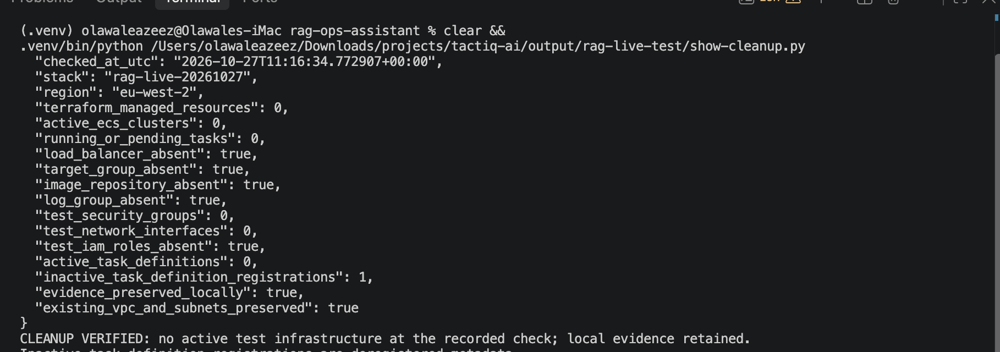

# Live AWS verification — 27 October 2026

[Project overview](../README.md) · [Earlier AWS deployment evidence](aws-deployment.md)

This record documents a temporary deployment of merged runtime commit
[`6956bc287dadbea34175a4e256457d3ee02de04f`](https://github.com/AZ1600/rag-ops-assistant/commit/6956bc287dadbea34175a4e256457d3ee02de04f).
The test endpoint was removed after verification. The deployment is not a current
public demo.

## Deployment and identity

| Item | Recorded value |
| --- | --- |
| Region | `eu-west-2` |
| Runtime | One Linux ARM64 Fargate task, 1 vCPU / 2 GiB |
| Image | `live-6956bc2`, verified by digest against the running task |
| Image digest | `sha256:da6662771f1409c3dadc05e088b014c9448617e3b6c82cb184e876a2ff0596ac` |
| Compressed image size | Approximately 557 MiB |
| Infrastructure | Dedicated temporary Terraform configuration and local state; 18 managed resources |
| Routing | Owner-restricted ALB, one healthy target, `/health` HTTP 200 |
| Existing network | Default VPC and two subnets read as data, preserved during cleanup |
| Model | `global.amazon.nova-2-lite-v1:0` through Bedrock |
| Method | Local Docker build → ECR upload → Terraform service activation → live ALB requests |

Only tracked application files, requirements, Dockerfile and documentation
snapshots from the recorded commit were used for the build context. The running
image digest and source label were checked. Local Terraform state/credentials
were excluded from that context. The [archived temporary template](live-evidence/terraform-config.tf.txt)
records the test configuration; account-specific variables, inventory, state and
full raw AWS responses remain local. The template's default stack name identifies
this session; a reproduction needs its own account, network inputs, owner /32 and
independent state.

This was a manual verification session. It did **not** rerun the GitHub Actions
OIDC/deployment pipeline, ECR vulnerability scanning, or the original Terraform
module's zero-drift check. Those earlier achievements remain documented separately.

## Live API results

Four selected POST requests were made through the ALB to the real FastAPI,
LangGraph, Bedrock and MCP stack. Each was attempted once without automatic
request retries. These are smoke examples, not an answer-accuracy benchmark.

| Case | HTTP | Observed request duration | Result |
| --- | ---: | ---: | --- |
| `quiet` | 200 | 2.08 s | Documented no-traffic answer; observability source and chunk 112 |
| `missing-tenant` | 200 | 0.77 s | Fixed refusal; empty sources/evidence |
| `private-dns` | 200 | 4.98 s | Azure source and chunks 9, 10, 30; inline-label mismatch recorded |
| `missing-retention` | 200 | 0.68 s | Fixed refusal; empty sources/evidence |

Durations are individual wall-clock observations, not a latency benchmark.
Raw API responses are preserved for [quiet service](live-evidence/query-quiet.json),
[missing tenant ID](live-evidence/query-missing-tenant.json),
[Private DNS](live-evidence/query-private-dns.json) and
[missing retention duration](live-evidence/query-missing-retention.json).

### Supported answer

The quiet-service answer correctly describes no application traffic as non-failure,
no new SLI samples without requests, and prevention of a false zero-availability
reading. It cites chunk `112`, which is present in the returned metadata and the
frozen no-traffic section. [Single-example review](live-evidence/quiet-answer-review.json).

### Missing-fact refusal

Both the production tenant-ID request and the production log-retention-duration
request returned the exact fixed abstention message, with empty sources and
evidence. HTTP 200 represents the designed refusal response, not successful
retrieval of an absent value.

## Model and tool trace

The exported CloudWatch trace records:

- **Four** `search_knowledge_base` tool requests.
- **Two** searches returning evidence and **two** reporting no evidence.
- **Six** Bedrock-node entries: the supported examples each have a tool-selection
  call followed by generation; the two refusal examples stop after retrieval.
- All four selected questions reaching the search tool verbatim, including the
  previously missed quiet-service wording.

The [selected trace](live-evidence/model-tool-trace.json) retains timestamps and
model/tool routing messages. The [summary](live-evidence/live-test-summary.json)
records the counts. No additional `/ask` requests were made while exporting logs.
The trace and API response verify the tested paths; they do not prove that the
model always chooses the search tool on unseen questions.

## Observed limitation

The Private DNS response returned the expected Azure document and evidence
chunks `9`, `10` and `30`, but its prose used `[1]` and `[3]`. The inline labels
therefore do not identify the chunk IDs returned by this API. The current smoke
check validates HTTP status and source/evidence presence; that is insufficient
to validate citation alignment or every generated claim.

This mismatch is retained in the [original response](live-evidence/query-private-dns.json)
and [limitation record](live-evidence/known-limitations.json). A follow-up should
validate or enforce inline citations against returned chunk IDs. The response
was not rewritten to hide this issue. No general generated-answer accuracy or
prompt-injection claim follows from these four examples.

## Healthy infrastructure

At `10:59 UTC`, the recorded check showed one desired/running task, zero pending
tasks, one healthy ALB target, the expected image digest, and `/health` HTTP 200.
The [deployment status](live-evidence/deployment-status.json) records the precise
check timestamp.

## Teardown and scope

The temporary state was destroyed after evidence export. Read-only AWS checks at
**11:16 UTC** confirmed:

- Zero managed Terraform resources, active test clusters and running/pending tasks.
- Test ALB, target group, ECR repository/images and log group absent.
- Test IAM roles, security groups and network interfaces absent.
- No active task definition; one inactive registration remained as deregistered metadata.
- The existing VPC and two subnets preserved.

The [cleanup summary](live-evidence/cleanup-summary.json) records those checks.
This establishes cleanup of this test, not absence of unrelated account resources
or charges. The full state and raw absence responses were preserved locally.

This screenshot displays the saved `11:16 UTC` verification record; displaying
it later did not rerun AWS checks or model inference.

## Session and cost record

The session marker was recorded at `10:40:42 UTC`; cleanup was verified at
`11:16:34 UTC`, an elapsed **35.9 minutes**. This is the setup/test/cleanup window,
not a measured Fargate billing duration. The operating budget was **£5**. The
actual billed total has not been checked against AWS billing data, and the budget
was not an AWS-enforced spending cap. [Session record](live-evidence/session.json).

## Relation to local evaluation

The preceding recorded results remain **144 deterministic tests**, **32/32 fixed
retrieval cases**, **12/12 targeted probes**, and **12/12 terminology boundary
cases**. Those model-backed evaluations measure retrieval over the fixed snapshots
and were not rerun as Bedrock answer grading during this session. Their cases
informed development; the new live examples are also selected development checks.

The fresh evidence adds actual container startup, IAM task-role access to Bedrock,
MCP integration, source-bearing answers, hard refusal paths, ALB health and
verified ephemeral-stack cleanup. It does not establish production readiness,
exhaustive answer faithfulness, load capacity or security-test coverage.
